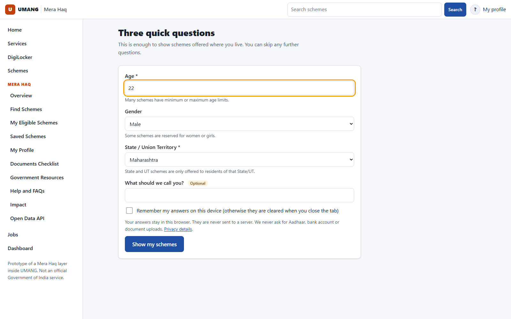
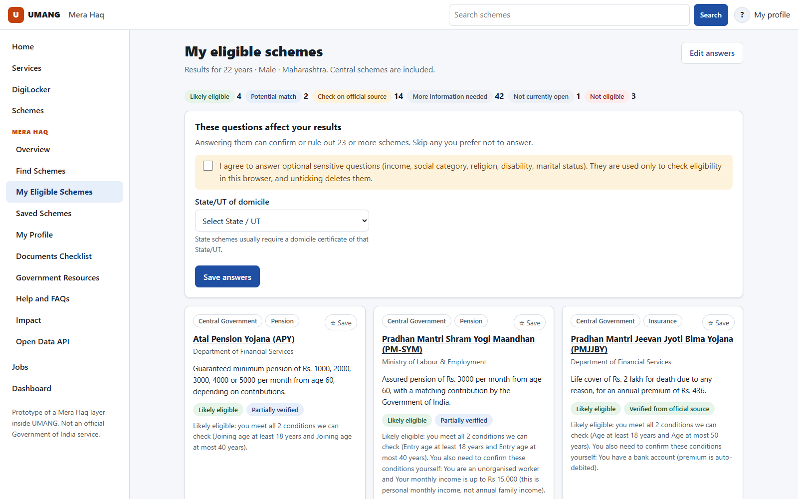
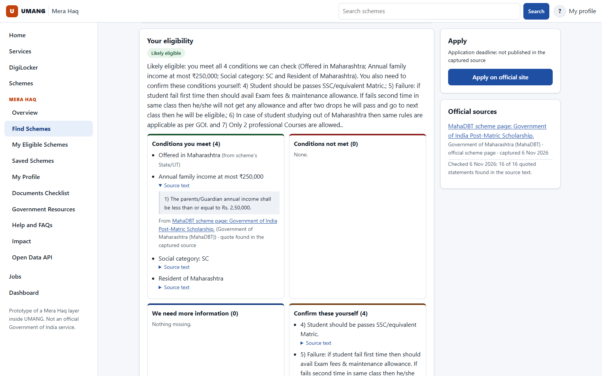
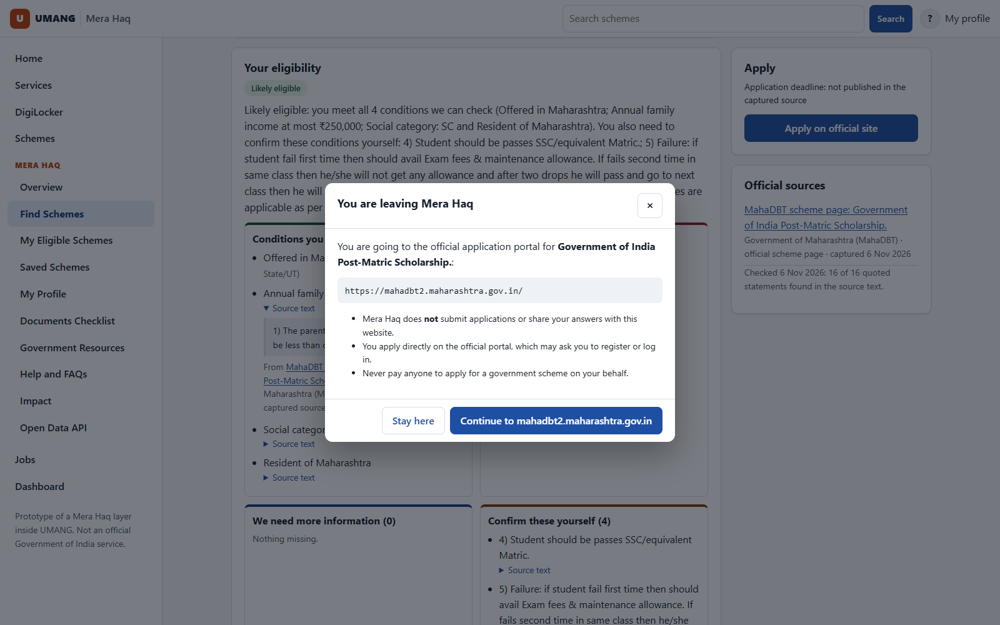
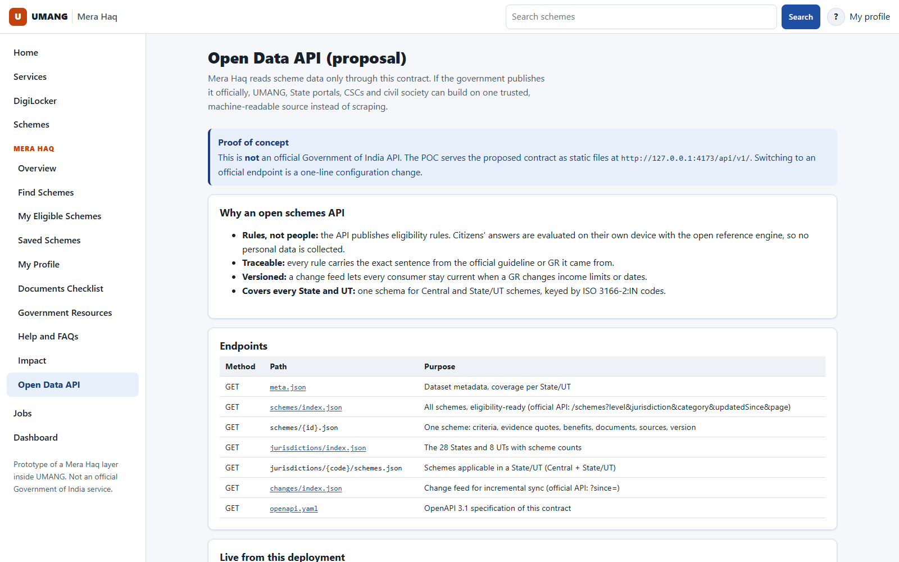
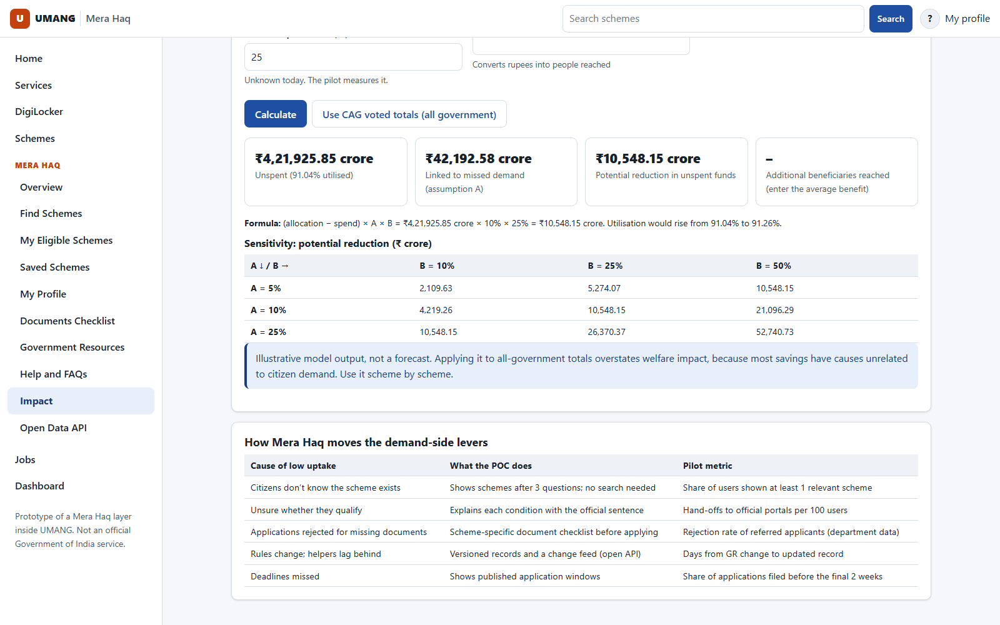

# Mera Haq Proof of Concept: Walkthrough

A guided tour of the working prototype, to share with [PROPOSAL.md](./PROPOSAL.md). Every screen below is a real screenshot of the POC running on real official data. Screenshots are regenerated with `node scripts/screenshots.mjs docs/img` while the dev server runs.

**Live:** https://devneeraj15.github.io/Mera-Haq/ (after the `feat/real-data-revamp` branch is merged) · **Run locally:** `npm ci && npm run build && npm run serve` → http://127.0.0.1:4173/

---

## 1. Three questions to start

- Only **age, gender and State/UT** are asked first. All 28 States and 8 UTs are listed separately.
- Answers stay in the browser, in session storage by default. Nothing is sent to a server.
- Invalid input (age 150, negative numbers, markup) is rejected with an accessible error message.

**What it proves:** discovery does not need a long form or any sensitive data up front.

## 2. Results grouped by honest outcome

- 66 real schemes (11 Central, 55 Maharashtra) are evaluated on the device in about 2 ms.
- Outcomes: *Likely eligible*, *Potential match*, *Check on official source*, *More information needed*, *Not currently open*, *Not eligible*.
- **"These questions affect your results"** asks only the questions that would change outcomes, ranked by how many schemes they affect. Sensitive questions need explicit consent.

**What it proves:** progressive profiling reduces effort without guessing.

## 3. Every result explained with the official sentence

- Conditions are shown as **met / not met / unknown / confirm yourself**. There is no score.
- **Source text** expands to the exact sentence from the official page. The validator has re-found it in a stored copy (here 16 of 16 quotes).
- The verification status (Verified, Partially verified, Needs review) is visible on every scheme.

**What it proves:** results are auditable, so an officer can check why the system said what it said.

## 4. Safe hand-off to the official portal

- Only verified government domains are opened, in a new tab with no opener.
- The dialog states that Mera Haq does not submit applications, and warns against paying agents.
- MahaDBT schemes link to **MahaDBT 2.0**, because the official notice on each scheme page says applications for AY 2026-27 are accepted only there.

**What it proves:** the platform guides citizens and never pretends to be the government.

## 5. The proposed Open Government Schemes API, already in use

- The app loads **all** its data through `api/v1/` (OpenAPI 3.1: [docs/api/openapi.yaml](./api/openapi.yaml)).
- Switching to an official endpoint (myScheme / API Setu) is one configuration line.
- Contract tests check every response against the spec and confirm it contains no personal-data fields.

**What it proves:** Option B (the open API) can be adopted without rebuilding anything.

## 6. Impact: less money left unspent

- **Official context** from the CAG's Report No. 6 of 2026 (FY 2024-25), quoted verbatim, including voted-provision savings of ₹4,21,925.85 crore and persistent savings in seven grants over three years.
- A **transparent model**: reduction = unspent × A × B. **A** is the share of unspent money caused by eligible citizens not applying; **B** is the share of that missed demand that discovery converts. Officials enter a scheme's BE and Actuals and their own assumptions.
- It states plainly that CAG does not attribute savings to low uptake, and that A and B must be measured in a pilot.

**What it proves:** the fiscal case can be quantified per scheme without overstating it.

---

## Suggested 10-minute live demo
1. Open the app and answer: 22, Male, Maharashtra → **Show my schemes** (screen 2).
2. Open *Government of India Post-Matric Scholarship*. Tick consent, enter income ₹2,00,000 and category SC → **Likely eligible** (screen 3).
3. Change income to ₹2,50,001 → the result flips to **Not eligible**: the boundary is enforced exactly.
4. Click **Apply on official site** to show the hand-off (screen 4), then press Esc.
5. Open **Open Data API** and pick a State (screen 5).
6. Open **Impact** and enter a scheme's BE and Actuals for the ministry in the room (screen 6).

## Quality evidence
77 automated tests: 37 unit (engine, API contract, impact model), 16 pipeline and 24 end-to-end on desktop and mobile. The real-data dry run checks 18 personas × 66 schemes against 210 hand-written expected outcomes, with 0 mismatches. Details: [TEST_REPORT.md](../TEST_REPORT.md).
